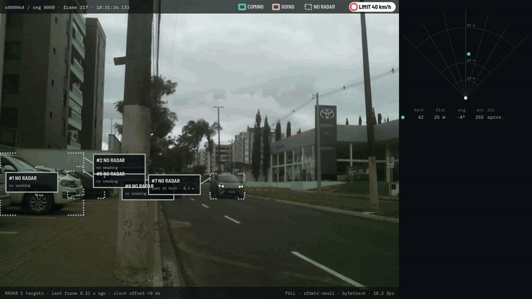
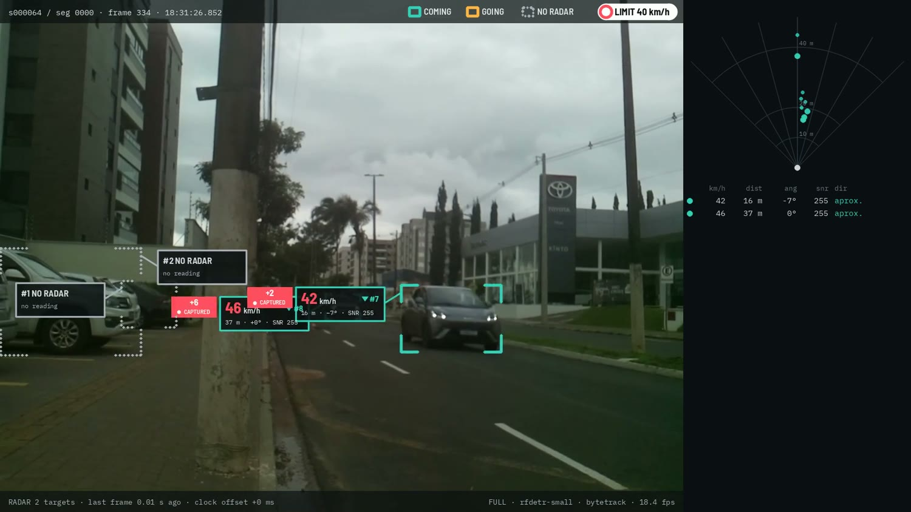
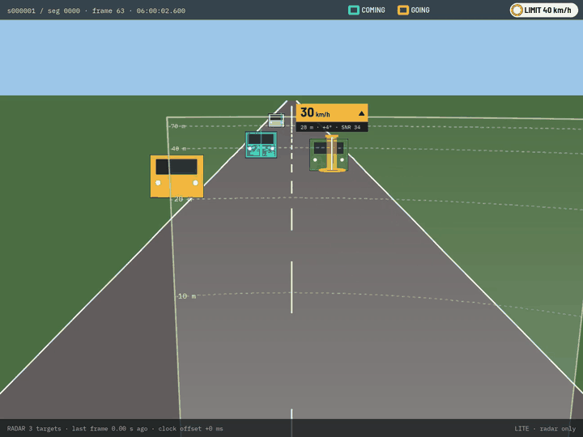
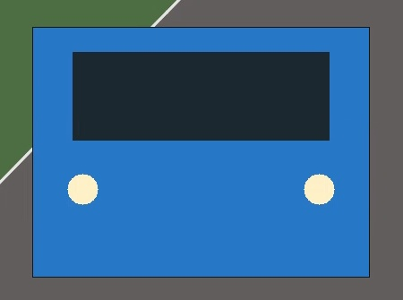
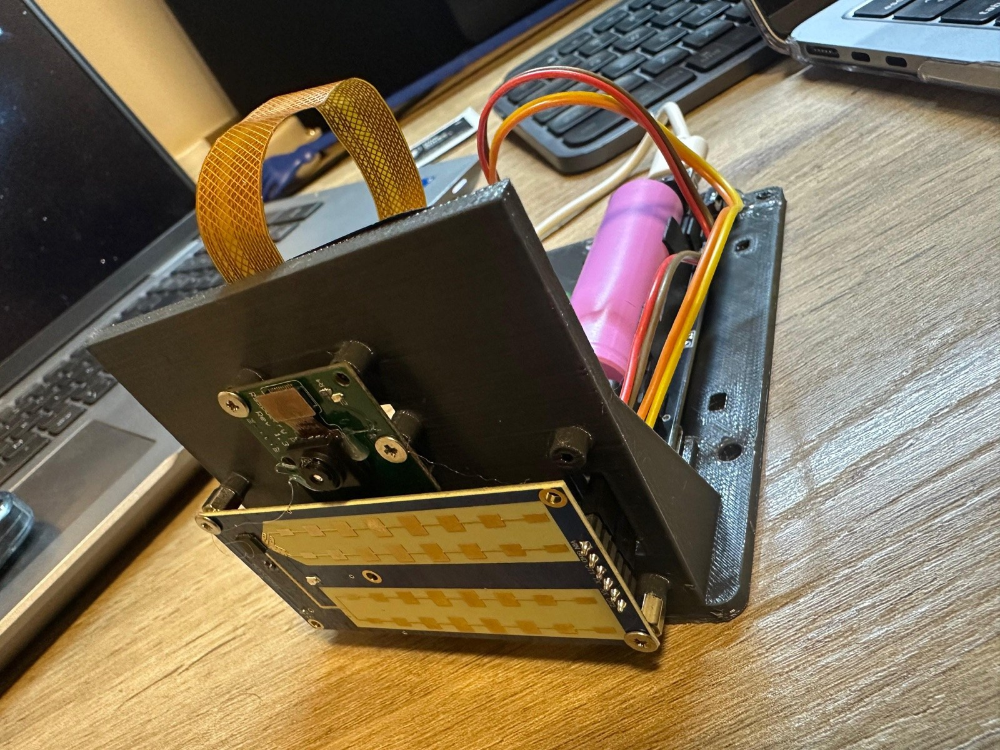
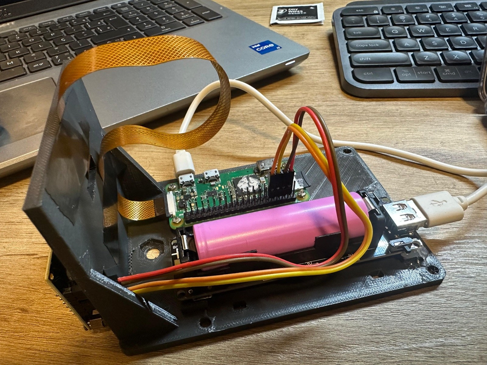
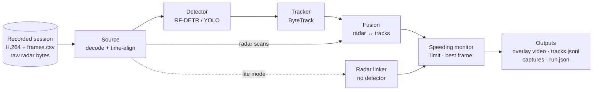

<div align="center">

# speed-trap

**Offline speed trap: fuse HLK-LD2451 radar readings with camera detection and tracking, and capture every vehicle over the limit.**

[](https://github.com/bfMendonca/hlk-ld2451-speed-trap/actions/workflows/ci.yml)
[](pyproject.toml)
[](LICENSE)
[](https://github.com/astral-sh/ruff)
[](https://mypy-lang.org/)
[](https://github.com/astral-sh/uv)
<br>
[](https://github.com/roboflow/rf-detr)
[](https://github.com/roboflow/trackers)
[](https://github.com/bfMendonca/ld2451)
[](https://github.com/bfMendonca/hlk-ld2451-speed-trap/stargazers)
[](https://github.com/bfMendonca/hlk-ld2451-speed-trap/network/members)
[](https://github.com/bfMendonca/hlk-ld2451-speed-trap/commits/main)

[Features](#features) ·
[Demo](#demo) ·
[Hardware](#hardware) ·
[How it works](#how-it-works) ·
[Install](#installation) ·
[Quick start](#quick-start) ·
[Calibration](#calibration) ·
[Contributing](CONTRIBUTING.md)

<br>



<sub>Full mode on a real recording (session s000064, limit 40 km/h). Two coming cars, at 42 and 46 km/h by radar, are tracked, matched to the radar and captured. The strip on the right is the radar's own view: a top-down fan with a fading trail and a table of the current readings.</sub>

</div>

---

A Raspberry Pi Zero records camera video and raw radar frames with
[`radar-cam-recorder`](https://github.com/bfMendonca/radar-cam-recorder). `speed-trap` takes
those sessions to a laptop and turns them into evidence:

- **an annotated video** per segment, where every vehicle carries its radar speed, distance,
  angle and SNR, and the radar's field of view is drawn on the road;
- **a track log** with the full speed history of every vehicle that came and went;
- **speeder captures**: a clean, full-resolution crop of each vehicle over the limit, with a
  JSON sidecar holding the radar readings behind the decision.

The guiding rule is **near but never wrong**: a capture must never overstate a speed or
attach a radar reading to the wrong vehicle. When in doubt, the vehicle stays gray and no
capture is made.

### Part of a three-repository project

| Repository | Role |
| --- | --- |
| [`ld2451`](https://github.com/bfMendonca/ld2451) | Python driver for the Hi-Link HLK-LD2451 24 GHz vehicle radar (UART protocol, record/replay) |
| [`radar-cam-recorder`](https://github.com/bfMendonca/radar-cam-recorder) | Unattended Raspberry Pi recorder: time-aligned H.264 video + raw radar sessions |
| **`speed-trap`** (this repo) | Offline processing: detection, tracking, radar fusion, overlay video and speeder captures |

## Features

- **Camera + radar fusion**: each detected box is back-projected onto the road plane and
  matched to radar targets with the Hungarian algorithm inside distance-aware gates.
- **Safeguards against wrong matches**: ambiguous pairs are dropped, the track's own
  direction and speed must agree with the radar, radar reports are compared with where the
  vehicles were *at the report's time*, and fusion stops at a 30 m trusted range.
- **Pluggable detectors**: [RF-DETR](https://github.com/roboflow/rf-detr) (Apache-2.0,
  default) or [Ultralytics YOLO](https://github.com/ultralytics/ultralytics) (optional),
  chosen in YAML and loaded only when used.
- **Tracking with timestamps, not frame counts**: ByteTrack with timeouts in seconds, because
  the Pi's real frame rate is irregular (about 20–22 fps, with dropped frames and gaps).
- **Lite mode**: no detector at all. Each radar target is drawn as a pillar on the road, which
  makes it fast on any laptop and the right tool for checking calibration.
- **Professional overlay**: corner brackets, speed tags with leader lines and a HUD with session
  time, legend and the speed limit. The radar coverage wedge with range rings is still available
  (`overlay.show.wedge`) but off by default.
- **Radar side panel**: a strip to the right of the overlay video with a top-down fan of the
  radar's own readings (3.5 s fading trail, coloured by direction) and a table of the current
  readings: speed, distance, angle, SNR, direction. It uses only radar data, never the camera
  calibration or fusion, and hides readings under 15 km/h. Configure it under
  `overlay.radar_panel`; the output video grows by `width_frac` (default one third).
- **Speeder captures**: the best frame of each pass (largest box, not cut by the frame edge),
  a JSON sidecar with the full radar history, and the config hash for traceability.
- **YAML-first configuration**: one validated config file, `--set key=value` overrides, and a
  fully commented default from `speed-trap init-config`.
- **Testable without hardware**: a synthetic session generator writes the real session format
  and LD2451 byte stream plus ground truth. End-to-end tests check every capture against it.
- **Ready for a live future**: the core stages do no file I/O and never read ahead in time,
  so a live camera/radar source can replace the recorded one.

## Demo

<table>
  <tr>
    <td width="50%"></td>
    <td width="50%"></td>
  </tr>
  <tr>
    <td align="center"><b>Full mode</b>: detector + tracker + radar fusion.<br><sub>Teal: coming · amber: going · gray dashed: no reliable radar reading.</sub></td>
    <td align="center"><b>Lite mode</b>: radar only, no detector.<br><sub>Pillar width is the radar's 1° angle step at that distance.</sub></td>
  </tr>
</table>

A speeding capture is a clean crop plus a sidecar
([full example](docs/images/capture-example.json)):

<table>
  <tr>
    <td width="32%"></td>
    <td>

```json
{
  "event": "speeding",
  "session": "s000001",
  "track_id": 4,
  "direction": "coming",
  "limit_kmh": 40.0,
  "speed_kmh": { "max": 60.0, "mean": 58.2, "at_capture": 55.0 },
  "capture": { "frame_index": 100, "sensor_ts_ns": 104240000000, "...": "..." },
  "radar_history": [
    { "speed_kmh": 60.0, "distance_m": 29, "angle_deg": 12, "snr": 37, "approaching": true },
    "..."
  ],
  "config_sha256": "f9cef8ee…"
}
```

</td>
  </tr>
</table>

> [!NOTE]
> The demo above is a synthetic session (flat-shaded vehicles and a simulated LD2451), rendered
> with the ground-truth detector. Footage from the real installation will replace it.

## Hardware

<div align="center">



<sub>The recording prototype: OV5647 camera and HLK-LD2451 radar on the front plate, Raspberry Pi Zero and battery on the base.</sub>
</div>

| Part | Notes |
| --- | --- |
| [Hi-Link HLK-LD2451](https://www.hlktech.com/en/Goods-245.html) | 24 GHz vehicle radar, up to 100 m; reports range, angle, speed, direction and SNR for up to 5 targets |
| Raspberry Pi Zero + OV5647 camera | Records 1296×972 H.264 with a kernel timestamp on every frame |
| 3D-printed plate | STL, wiring and the recorder service live in [`radar-cam-recorder`](https://github.com/bfMendonca/radar-cam-recorder) |

Processing runs on a laptop. Development used an Apple M2 with 8 GB of RAM; RF-DETR runs on
the Apple GPU (`device: mps`), CUDA or the CPU.

## How it works



1. **Source** decodes the raw H.264 and takes each frame's timestamp from the recorder's
   `frames.csv`. Each frame gets the radar reports that arrived since the previous one (both
   streams share the Pi's boot clock).
2. **Detector** finds vehicles (car, truck, bus, motorcycle by default). It can run on every
   Nth frame, with the tracker predicting the boxes in between.
3. **Tracker** keeps one identity per vehicle across frames.
4. **Fusion** places each box and each radar target on the road plane using the camera and
   radar geometry from the config, and assigns them one to one.
5. **Speeding monitor** triggers when a reliable track exceeds the limit for several
   consecutive radar readings, keeps the best frame and writes the capture when the track ends.

### Near but never wrong

| Safeguard | What it prevents |
| --- | --- |
| 30 m fusion range (`fusion.max_range_m`) | Matches where the camera's road position is too uncertain |
| Distance-aware gates, Hungarian assignment | A reading going to a vehicle in another place or lane |
| Ambiguity guard (ties and near-ties dropped) | Guessing between two plausible vehicles |
| Readings compared at their own timestamp; stale ones skipped | A following car inheriting the car in front's reading after a frame gap |
| Direction and speed consistency with the track's own motion | A parked or slower car taking a passing car's speed |
| At least one *verified* reading before a capture | A brand-new track being captured on position alone |
| Raw radial speed by default (cosine correction off) | Overstating speed: the radial component reads slightly low |

## Installation

Requires Python 3.10+ and [uv](https://docs.astral.sh/uv/). The radar driver and the session
reader are installed from GitHub automatically.

```sh
git clone https://github.com/bfMendonca/hlk-ld2451-speed-trap.git
cd hlk-ld2451-speed-trap
uv sync                   # base install: lite mode, synth, tests (no torch)
uv sync --extra rfdetr    # + RF-DETR detector for full mode (default backend)
uv sync --extra yolo      # + Ultralytics YOLO detector (AGPL-3.0, see License)
```

`uv sync` installs exactly the extras you name, so repeat `--extra rfdetr` on later syncs to
keep the detector.

## Quick start

No recording yet? Generate a synthetic session: a two-lane road with traffic in both
directions, a parked car, irregular frame timestamps, a gap between segments, and radar
reports in the real LD2451 byte format, with ground truth.

```sh
uv run speed-trap synth demo                     # writes demo/s000001
uv run speed-trap init-config demo/cfg.yaml      # commented default config

# Lite mode: radar pillars only, no detector
uv run speed-trap process demo/s000001 --config demo/cfg.yaml --mode lite --capture

# Full mode with the ground-truth "detector" (synthetic vehicles are not meant to fool a real model)
uv run speed-trap process demo/s000001 --config demo/cfg.yaml --capture \
    --set detector.backend=ground_truth --set detector.weights=demo/s000001/truth.json

# Full mode on a real recording, with the detector from the config (RF-DETR by default)
uv run speed-trap process ~/recordings/s000012 --config cfg.yaml --capture
```

Outputs land in `out/<session_id>/` (`--out DIR` changes the parent to `DIR/<session_id>/`).
A run never overwrites an earlier one: if that folder exists, it writes `<session_id>-2/`,
`-3/`, and so on.

## Command line

```text
speed-trap process SESSION_DIR --config cfg.yaml
           [--segment N ...] [--start S] [--end S]     # seconds from session start
           [--mode full|lite] [--device cpu|mps|cuda]
           [--out DIR] [--capture/--no-capture]        # writes DIR/<session>[-N]
           [--set KEY=VALUE ...]                       # dotted key, e.g. speed.limit_kmh=50
           [-v/-vv]
speed-trap init-config PATH
speed-trap check-config --config cfg.yaml [--set ...]
speed-trap synth OUT_DIR [--config cfg.yaml] [--duration S] [--seed N]
```

Exit codes: `0` success, `1` runtime error, `2` usage, config or session error, `130`
interrupted. Errors are one line on stderr (`-vv` adds the traceback), and a failed run still
writes `run.json` with an `error` field. Nothing is written until the config and the session
have been validated. Progress (frames/s and an ETA) is printed at least every 5 s.

## Configuration

All parameters live in one YAML file, which `process` always requires. Create a complete,
commented one with `speed-trap init-config cfg.yaml`; every key states its unit and valid
range. Unknown keys and out-of-range values are errors that name the dotted key, and
`check-config` prints the effective config including `--set` overrides.

| Section | What it sets |
| --- | --- |
| `camera` | intrinsics (optional OpenCV matrix + distortion, with the calibration resolution) and pose (height, pitch, roll, yaw) |
| `radar` | position relative to the camera, boresight, field of view, range, angle sign, direction byte, clock offset, report hold time |
| `road` | lane heading (for the optional cosine correction) |
| `detector` | backend (`rfdetr`, `ultralytics`, `ground_truth`), weights, device, `imgsz` (default 512), thresholds, classes, region of interest, `every_n_frames` |
| `tracker` | ByteTrack thresholds and the lost-track timeout in seconds |
| `fusion` | gates, ambiguity ratio, `max_range_m`, scan age, speed tolerance, optional lane boundaries, reliability rules |
| `speed` | limit (with optional per-direction overrides) and the cosine correction (off) |
| `capture` | on/off, consecutive over-limit readings, crop margin, full frame, JPEG quality |
| `overlay`, `lite` | what to draw, colors, pillar height |
| `output`, `synth` | output directory and codec, synthetic session parameters |

## Outputs

| File | Content |
| --- | --- |
| `NNNN.overlay.mp4` | Annotated H.264 video per segment. Variable frame rate from the frame timestamps, so playback runs in real time despite dropped frames. |
| `tracks.jsonl` | One line per finished track (or radar subject in lite mode): id, class, first/last time, direction, boxes, road positions, radar matches, `reliable_ever`, max/mean speed. |
| `captures/*.jpg` | Full-resolution crop of each speeding vehicle, without overlay (lite mode: the overlay frame). The file name never rounds the speed up. |
| `captures/*.json` | Sidecar: direction, limit, speed max/mean/at capture, frame index, sensor timestamp, wall-clock time (flagged unreliable without NTP), box, detector confidence, full radar history, config hash. |
| `run.json` | Effective config and its hash, package versions, model, counters (frames, scans, tracks, matches, captures), warnings, and `error` if the run failed. |

## Calibration

Fusion is only as good as the geometry, so set it up before trusting full-mode captures.

1. **Camera intrinsics.** Calibrate the OV5647 with any OpenCV checkerboard script and paste
   the camera matrix and distortion coefficients into `camera.intrinsics`, with the
   resolution you calibrated at (it is scaled to the video size). Without intrinsics, a
   pinhole from the sensor's nominal field of view is used with a warning: good enough for
   lite mode, not for captures.
2. **Pose.** Measure the camera height above the road. Get the pitch from a phone
   inclinometer, or adjust it until the drawn range rings fall on road markings at known
   distances. Measure the radar's offset from the camera (x forward, y left, z up) and its yaw.
3. **Check the radar conventions in lite mode on the first real recording.** The angle sign
   and the direction byte come from the datasheet and are not yet confirmed on hardware:
   - pillars on the wrong side of the road: flip `radar.angle_sign`;
   - approaching vehicles drawn as going (▲ instead of ▼): flip `radar.approaching_byte`;
   - pillars consistently ahead of or behind the vehicles: adjust `radar.clock_offset_ms`.

## Known limits

- **30 m fusion range.** Matching, colored tracks and captures stop at `fusion.max_range_m`.
  Farther radar targets are drawn as thin pillars but never attached to a vehicle.
- **Flat road.** Back-projection assumes the road is a plane; slopes and crowns shift the
  road positions and with them the gates.
- **Radar quantisation.** The LD2451 reports integer metres, degrees and km/h, and at most five
  targets per report. Two vehicles within about a metre and a degree of each other cannot be
  told apart; such matches are dropped as ambiguous.
- **Radial speed.** The radar measures the speed along its line of sight, which reads slightly
  low. The cosine correction is off by default so captures never overstate.
- **Stationary vehicles** are not reported by the radar and stay gray.
- **Lite mode identity swaps.** Without a camera, two vehicles overtaking in the same lane can
  swap radar subjects; this can add a capture but never raises a reading.
- **Frame gaps.** Radar reports from a camera outage longer than `fusion.max_scan_age_s` are not
  matched, because the vehicles cannot be placed at the time of the report.
- **Overlapping tags.** When vehicles bunch up, their tags can overlap.
- **RF-DETR checkpoint paths.** A `detector.weights` path (rather than a model name) is loaded
  as an RF-DETR Base checkpoint with COCO class ids; fine-tuned models need code changes.
- **FFmpeg warning on macOS.** PyAV and OpenCV each bundle FFmpeg, so runs may print a harmless
  Objective-C warning about duplicate classes (`AVFFrameReceiver`).

## Roadmap

- [ ] Process footage from the real installation and replace the synthetic demo
- [ ] Live processing on a Jetson or a stream receiver (the core is already causal and I/O-free)
- [ ] Automatic camera–radar calibration from matched passes
- [ ] Licence-plate reading on speeder captures
- [ ] Tag layout that avoids overlaps

## Development

```sh
uv sync --extra rfdetr     # or plain `uv sync` to skip the detector tests
uv run pytest
uv run ruff check . && uv run ruff format --check . && uv run mypy
```

The end-to-end tests generate synthetic sessions (including frame gaps and a car passing
in front of a parked one) and check every capture, track and the parked vehicle against the
ground truth, in both modes. The design spec and implementation plan are in
[`docs/design/`](docs/design/). See [CONTRIBUTING.md](CONTRIBUTING.md) before opening a pull
request.

## License

[MIT](LICENSE). The main dependencies are permissively licensed: RF-DETR, ByteTrack
(`trackers`) and OpenCV are Apache-2.0, `supervision` and pydantic are MIT, and PyAV is
BSD-3-Clause (its binary wheels bundle FFmpeg, which has its own licence).

The optional `yolo` extra installs [Ultralytics](https://github.com/ultralytics/ultralytics),
which is licensed under **AGPL-3.0**; if you install and use it, its terms apply to the
combined work. The fonts in `speed_trap/render/fonts` (Barlow Semi Condensed, IBM Plex Mono)
are under the SIL Open Font License (`OFL-*.txt` beside them).

## Acknowledgements

[RF-DETR](https://github.com/roboflow/rf-detr), [trackers](https://github.com/roboflow/trackers)
and [supervision](https://github.com/roboflow/supervision) by Roboflow;
[PyAV](https://github.com/PyAV-Org/PyAV); [OpenCV](https://opencv.org/);
[Barlow](https://github.com/jpt/barlow) and [IBM Plex](https://github.com/IBM/plex) fonts.

## Star history

<a href="https://star-history.com/#bfMendonca/hlk-ld2451-speed-trap&Date">
  <picture>
    <source media="(prefers-color-scheme: dark)" srcset="https://api.star-history.com/svg?repos=bfMendonca/hlk-ld2451-speed-trap&type=Date&theme=dark">
    <source media="(prefers-color-scheme: light)" srcset="https://api.star-history.com/svg?repos=bfMendonca/hlk-ld2451-speed-trap&type=Date">
    
  </picture>
</a>
